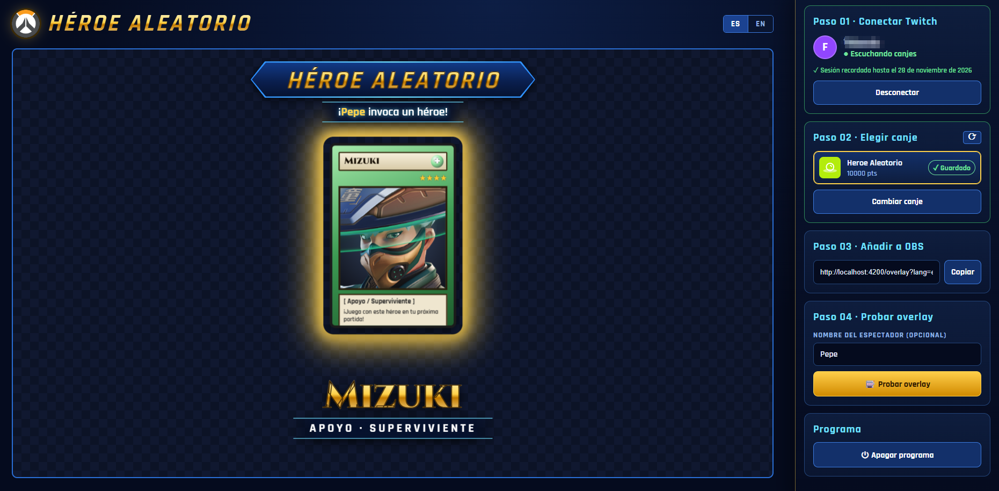
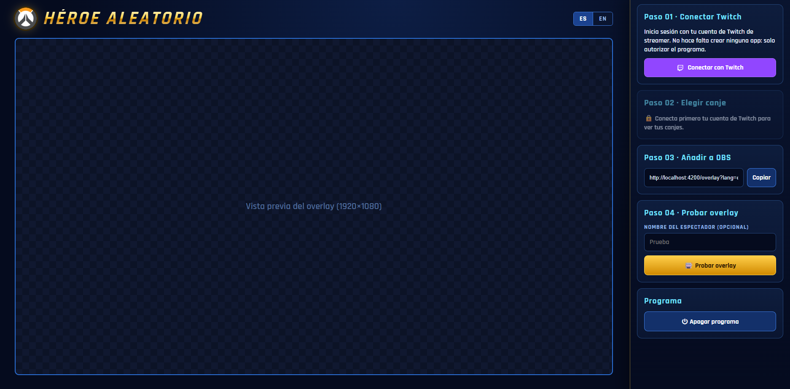
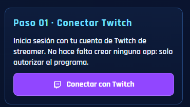
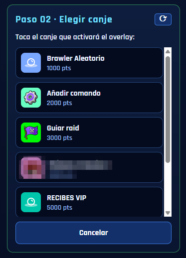
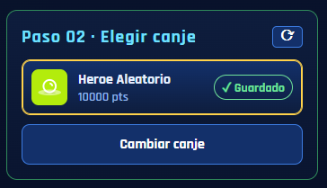
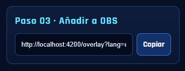
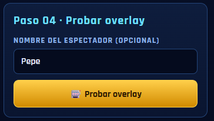

# Héroe Aleatorio

[](https://angular.dev)
[](https://www.typescriptlang.org)
[](https://nodejs.org)
[](https://rxjs.dev)
[](https://jsverse.github.io/transloco/)
[-010101?style=flat-square)](https://github.com/websockets/ws)

[](https://dev.twitch.tv/docs/eventsub/)
[](https://dev.twitch.tv/docs/authentication/getting-tokens-oauth/#device-code-grant-flow)
[](https://overfast-api.tekrop.fr)
[](https://obsproject.com)

[](#arquitectura-ddd)
[](#idiomas-i18n)
[](#requisitos)
[](#aviso)

**Overlay para OBS que une el estilo de duelo de cartas de Yu-Gi-Oh! con los héroes de Overwatch.** Cuando un espectador canjea con puntos de canal la recompensa que elijas en Twitch, aparece en directo una mesa de duelo:
1. El mazo cae y se baraja.
2. Las cartas giran en un torbellino y se reparten en abanico.
3. Una luz las recorre como una ruleta y se detiene en una.
4. Esa carta se da la vuelta: *«¡[espectador] invoca un héroe!»*.

El héroe que sale es el que tendrás que jugar en tu próxima partida.

Está pensado para **streamers de Overwatch y su comunidad**: los espectadores deciden con qué héroe juegas, tú no tienes que configurar nada técnico y cualquiera puede usarlo en su canal. Solo hace falta pulsar **Conectar con Twitch**, sin crear apps de desarrollador ni copiar claves.

## Capturas

**Una tirada en marcha.** Un espectador «Pepe» invoca a Mizuki (Apoyo · Superviviente). Así se ve en la vista previa del panel y en OBS:



**El panel antes de conectar Twitch.** A la izquierda, la vista previa del overlay (1920 × 1080); a la derecha, los pasos:



**Los pasos, uno a uno:**

| Paso 01 · Conectar Twitch | Paso 02 · Elegir canje |
|:---:|:---:|
|  |  |
| Un solo botón: sin crear apps ni copiar claves. | Aparecen los canjes públicos del canal: se elige uno con un toque. |

| Paso 02 · Canje guardado | Paso 03 · Añadir a OBS | Paso 04 · Probar overlay |
|:---:|:---:|:---:|
|  |  |  |
| El paso se compacta y recuerda el canje 30 días. | La URL ya lleva el idioma; se pega en OBS como fuente de navegador. | Lanza una tirada de prueba sin gastar puntos. |

---

## Requisitos

- **Windows** (el programa se abre y se cierra con `start.bat` y `stop.bat`).
- **[Node.js](https://nodejs.org) 22 o superior** (la versión LTS sirve).
- Un canal de Twitch **Afiliado o Partner**: Twitch solo da puntos de canal a esos canales.
- **OBS Studio** (o cualquier programa de streaming con fuente de navegador).

## Primera vez

1. Haz doble clic en **`start.bat`**. La primera vez descarga las dependencias y compila la web, así que tarda unos minutos y necesita internet. Después se abre el panel en `http://localhost:4200`.
2. Sigue los pasos de la barra lateral:

| Paso | Qué hacer |
|---|---|
| **01 · Conectar Twitch** | Pulsa **Conectar con Twitch**. Se abre Twitch en otra pestaña con el código ya puesto: inicia sesión con tu cuenta de streamer, pulsa *Activar* y después *Autorizar*. El panel se conecta solo. |
| **02 · Elegir canje** | Aparecen los canjes públicos de tu canal. Toca el que activará el overlay. Se guarda por su ID, así que aunque le cambies el nombre en Twitch sigue funcionando. Si la lista está vacía, crea el canje en Twitch y pulsa ⟳. |
| **03 · Añadir a OBS** | Pulsa **Copiar**. En OBS añade *Fuentes → + → Navegador*, pega la URL y pon **1920 × 1080**. |
| **04 · Probar overlay** | Escribe un nombre (opcional) y pulsa **Probar overlay**. La tirada sale en la vista previa del panel y en OBS sin gastar puntos. |

> Abre `start.bat` **antes** que OBS. Si OBS ya estaba abierto, haz clic derecho en la fuente → *Actualizar*.

## Uso diario

- **Encender**: doble clic en `start.bat`. El programa funciona **en segundo plano, sin ventana**. Si ya estaba encendido, solo abre el panel.
- **Apagar**: botón **⏻ Apagar programa** del panel, o doble clic en `stop.bat`.
- **Sin repetir pasos**: la sesión de Twitch se renueva sola mientras el programa está encendido. Ella y el canje elegido se recuerdan **30 días**; después basta con volver a pulsar **Conectar con Twitch**.
- **Varios canjes seguidos**: si llegan a la vez, se muestran uno detrás de otro.

## Opciones del overlay

Se añaden a la URL de OBS (el panel ya te la da con el idioma puesto):

| Opción | Para qué |
|---|---|
| `?lang=es` / `?lang=en` | Idioma de los textos del overlay y de los nombres de los héroes |
| `&warnings` | Muestra en pantalla los avisos de conexión (sin Twitch, sin canje…). Por defecto están ocultos para no tapar el directo |
| `&demo` | Lanza una tirada de prueba al abrir el overlay |

Ejemplo: `http://localhost:4200/overlay?lang=es&warnings`

## Si algo falla

| Síntoma | Solución |
|---|---|
| «Sin conexión con el programa» | Está apagado: ábrelo con `start.bat`. |
| «El servidor no arrancó» | Mira `logs/server.err.log`. |
| «El puerto 4200 ya está en uso» | Otro programa usa ese puerto. Prueba con `stop.bat` y vuelve a abrir `start.bat`. |
| «El código caducó» | Hay 30 minutos para autorizar en Twitch: pulsa otra vez **Conectar con Twitch**. |
| «Tu canal necesita ser Afiliado o Partner» | Twitch solo tiene puntos de canal en esos canales. |
| No pasa nada al canjear | Revisa en el paso 02 que el canje elegido sea el que se está canjeando. Añade `&warnings` a la URL de OBS para ver el motivo en pantalla. |
| «No se pudo cargar la lista de héroes» | OverFast API no responde. Si ya se había cargado antes, el programa usa la última copia guardada. |

## Tus datos y privacidad

Todo se queda en tu ordenador, dentro de la carpeta del programa:

| Archivo | Contenido |
|---|---|
| `data/settings.json` | Canje elegido y tokens de tu sesión de Twitch. **No lo compartas.** |
| `logs/server.log` | Registro del programa. No incluye tu usuario de Twitch ni rutas de tu ordenador, así que puedes compartirlo para pedir ayuda. |
| `logs/server.err.log` | Errores del programa. |
| `server.pid` | Proceso en marcha (lo usan `start.bat` y `stop.bat`). |

- **La web nunca ve tus tokens**: solo los usa el programa local para hablar con Twitch.
- **Solo tu ordenador puede usarlo**: el programa escucha en `localhost` y rechaza peticiones de otras webs.
- **Para empezar de cero**, borra `data/settings.json`.

---

## Tecnologías y dependencias

### Web (panel y overlay) — `web/`

| Dependencia | Versión | Para qué la usamos |
|---|---|---|
| [Angular](https://angular.dev) (`core`, `common`, `router`, `platform-browser`, `forms`, `compiler`) | 22 | Framework de la web: componentes *standalone* y *signals* para el estado reactivo. Rutas `/` (panel) y `/overlay` (OBS). |
| [@jsverse/transloco](https://jsverse.github.io/transloco/) | 8 | Traducciones (español e inglés) cargadas desde `public/i18n/*.json`. |
| [RxJS](https://rxjs.dev) | 7.8 | Flujo de canjes en tiempo real hacia el overlay. |
| tslib | 2 | Funciones auxiliares que necesita el código compilado de TypeScript. |
| *Desarrollo:* `@angular/cli`, `@angular/build`, `@angular/compiler-cli` | 22 | Compilar la web (`ng build`) y servidor de desarrollo con recarga en caliente. |
| *Desarrollo:* [TypeScript](https://www.typescriptlang.org) | 6.0 | Lenguaje de todo el proyecto, en modo estricto. |
| *Desarrollo:* [Prettier](https://prettier.io) | 3.8 | Formato del código. |

### Programa local (servidor) — `server/`

| Dependencia | Versión | Para qué la usamos |
|---|---|---|
| [Node.js](https://nodejs.org) | 22+ | Ejecuta el servidor. Usa su `fetch` y su cliente `WebSocket` integrados para hablar con Twitch. |
| [tsx](https://tsx.is) | 4 | Ejecuta TypeScript directamente, sin compilar antes, y entiende los alias `@domain/*` y `@contract/*`. |
| [ws](https://github.com/websockets/ws) | 8 | Servidor WebSocket (`/ws`) que envía al panel y al overlay el estado y los canjes al instante. |
| *Desarrollo:* TypeScript, `@types/node`, `@types/ws` | 6.0 | Comprobación de tipos (`npm run typecheck`). |

El servidor HTTP no usa ningún framework: es el módulo `node:http` de Node.

### Servicios externos

| Servicio | Para qué |
|---|---|
| **Twitch — Device Code Flow** (OAuth) | Inicio de sesión sin URL de redirección: el programa usa su propia app de Twitch de tipo *Public*, así que el streamer no tiene que crear nada en dev.twitch.tv. Permiso usado: `channel:read:redemptions`. |
| **Twitch — Helix** | Lista de recompensas de puntos de canal del canal (paso 02). |
| **Twitch — EventSub por WebSocket** | Recibir los canjes en tiempo real, con reconexión automática. |
| **[OverFast API](https://overfast-api.tekrop.fr)** | Lista de héroes de Overwatch con su retrato, rol y subrol, traducida al idioma elegido. API no oficial. |
| **Google Fonts** | Tipografías *Cinzel* (cartas) y *Rajdhani* (interfaz). |

---

## Arquitectura DDD

El proyecto usa **Domain-Driven Design (DDD)**: las reglas del negocio viven en un **dominio** de TypeScript puro, sin Angular, sin Node y sin Twitch, y todo lo demás se organiza a su alrededor en capas.

| Capa | Qué contiene | Dónde |
|---|---|---|
| **Dominio** | Entidades, agregados, errores de negocio y **puertos** (interfaces de lo que el dominio necesita del exterior) | `shared/domain/` |
| **Aplicación** | **Casos de uso**: conectar Twitch, elegir canje, reenviar canjes, crear tiradas… | `server/src/application/`, `web/src/app/application/` |
| **Infraestructura** | **Adaptadores** que implementan los puertos: Twitch, OverFast, disco, HTTP, WebSocket | `server/src/infrastructure/`, `web/src/app/infrastructure/` |
| **Presentación** | Componentes de Angular: panel, overlay y animación de cartas | `web/src/app/presentation/` |

Las dependencias van siempre hacia el dominio:

```
presentation ──► application ──► domain ◄── infrastructure
```

El dominio no conoce a nadie. Por eso, para cambiar de juego basta con otro adaptador de `HeroRepository`, y para cambiar de plataforma de canjes basta con otro de `RedemptionSource`.

### Lenguaje del dominio

| Concepto | Clase | Qué representa |
|---|---|---|
| Sesión | `Session` | La sesión de Twitch del streamer: se renueva sola y se recuerda 30 días. |
| Código de activación | `ActivationCode` | El código para autorizar el programa en twitch.tv/activate. |
| Ajustes del streamer | `StreamerSettings` | El canje elegido (por ID o título), recordado 30 días. |
| Recompensa | `Reward` | Recompensa de puntos de canal creada en Twitch. |
| Canje | `Redemption` | Un espectador canjeó una recompensa (o una prueba del panel). |
| Héroe | `Hero` | Héroe de Overwatch con su rol y subrol. |
| Tirada | `Draw` | **Agregado principal**: las cartas que salen a la mesa y cuál es la elegida, decidido desde el principio. |

### Assemblers

Las entidades del dominio nunca viajan tal cual. Cada vez que un dato entra o sale (API, WebSocket, disco o servicios externos), un **assembler** lo convierte con métodos estáticos: `toEntityFromResource`, `toResourceFromEntity`, `toEntitiesFromResponse`…

| Assembler | Dónde | Convierte |
|---|---|---|
| `SettingsAssembler`, `RewardAssembler`, `RedemptionAssembler`, `ActivationAssembler`, `SessionAssembler`, `ErrorAssembler` | `shared/contract/assemblers/` | Entidad ↔ *resource* de la API (los usan la web y el servidor) |
| `SessionRecordAssembler` | `server/src/infrastructure/storage/` | `Session` ↔ registro guardado en `data/settings.json` |
| `TwitchRewardAssembler`, `TwitchRedemptionAssembler` | `server/src/infrastructure/twitch/` | Respuestas de Twitch (Helix, EventSub) → entidades |
| `HeroAssembler` | `web/src/app/infrastructure/overfast/` | Héroes de OverFast API ↔ `Hero` |

## Estructura de carpetas

```
heroe-aleatorio/
├── shared/                    Código que usan la web y el servidor
│   ├── domain/                  Dominio: TypeScript puro
│   │   ├── common/                DomainError, retención de 30 días, puerto RandomGenerator
│   │   ├── session/               Session, ActivationCode, puerto SessionRepository
│   │   ├── settings/              StreamerSettings, puerto SettingsRepository
│   │   ├── reward/                Reward
│   │   ├── redemption/            Redemption, puerto RedemptionSource
│   │   ├── hero/                  Hero, puerto HeroRepository
│   │   └── draw/                  Agregado Draw
│   └── contract/                Contrato servidor ↔ web (sin tokens)
│       ├── api.ts                 Resources: la forma JSON de cada dato que viaja
│       └── assemblers/            Entidad ↔ resource
│
├── server/                    Programa local (Node + tsx)
│   └── src/
│       ├── application/           SessionManager, SettingsManager, RedemptionRelay, RewardCatalog + puertos
│       ├── infrastructure/
│       │   ├── twitch/              Device Code Flow, EventSub, Helix + assemblers
│       │   ├── storage/             data/settings.json (escritura atómica)
│       │   └── web/                 WebServer: HTTP + WebSocket
│       ├── config.ts              Puerto, app de Twitch y rutas
│       └── main.ts                Raíz de composición: une puertos y adaptadores
│
├── web/                       Panel y overlay (Angular)
│   ├── src/app/
│   │   ├── application/           ServerStateService, SessionService, SettingsService,
│   │   │                          RedemptionsService, DrawsService + puerto LocalServer
│   │   ├── infrastructure/        local-server (HTTP + WebSocket), overfast, random, storage
│   │   ├── presentation/          panel, overlay, roulette (animación de cartas), i18n
│   │   └── config.ts              Cartas en la mesa, segundos en pantalla, API de héroes
│   ├── public/i18n/             Traducciones: es.json y en.json
│   └── scripts/check-i18n.mjs   Comprueba que todos los idiomas tienen las mismas claves
│
├── docs/capturas/             Capturas del README
├── data/                      settings.json (se crea solo)
├── logs/                      server.log y server.err.log (se crean solos)
├── start.bat                  Instala y compila (solo la primera vez) y arranca en segundo plano
└── stop.bat                   Detiene el programa
```

## API del programa local

Solo escucha en `localhost` y solo acepta peticiones de su propia web.

| Método | Ruta | Para qué |
|---|---|---|
| GET | `/api/health` | Comprobar que el programa responde (lo usa `start.bat`) |
| GET | `/api/state` | Canje elegido, sesión, código de activación pendiente, estado de la escucha y último error |
| POST | `/api/session` | Pedir a Twitch un código (devuelve el enlace con el código ya puesto) |
| DELETE | `/api/session` | Desconectar Twitch o cancelar el inicio de sesión |
| GET | `/api/rewards` | Canjes públicos del canal, ordenados por coste (necesita sesión) |
| PUT | `/api/reward` | Guardar el canje elegido (`id` + `title`) |
| POST | `/api/test` | Canje de prueba (`viewerName`) |
| POST | `/api/shutdown` | Cerrar el programa |
| WS | `/ws` | Estado en vivo y canjes |

Los errores se devuelven como **códigos** (`{ "code": "loginRequired" }`), nunca como frases. Así cada interfaz los muestra en su idioma.

## Idiomas (i18n)

- **Panel**: botones **ES / EN** arriba a la derecha. La elección se recuerda.
- **Overlay**: usa el idioma de su URL (`?lang=es` o `?lang=en`). Los nombres de los héroes también llegan traducidos desde OverFast API.
- **Errores**: viajan como códigos desde el dominio y el servidor, y la web los traduce con la clave `errors.<código>`.

## Desarrollo

```bash
# Programa local (puerto 4200), con la salida en la consola
cd server
npm install
npm start
npm run typecheck      # comprobación de tipos (incluye shared/)

# Web con recarga en caliente (puerto 4201, con proxy a la API del 4200)
cd web
npm install
npm start
npm run build          # compila en web/dist/web/browser (lo que sirve el programa)
npm run check          # comprueba las traducciones y compila
```

`start.bat` solo compila la web si falta `web/dist/`. Después de cambiar la web, ejecuta `npm run build` en `web/` (o borra `web/dist/`) y reinicia con `stop.bat` + `start.bat`.

---

## Aviso

Proyecto creado por un fan, sin relación con Blizzard Entertainment, Konami ni Twitch. *Overwatch* es una marca de Blizzard Entertainment y *Yu-Gi-Oh!* es una marca de Konami. El overlay solo se inspira en su estilo.

WAAAAAAAAAAAAAAAAAAA.